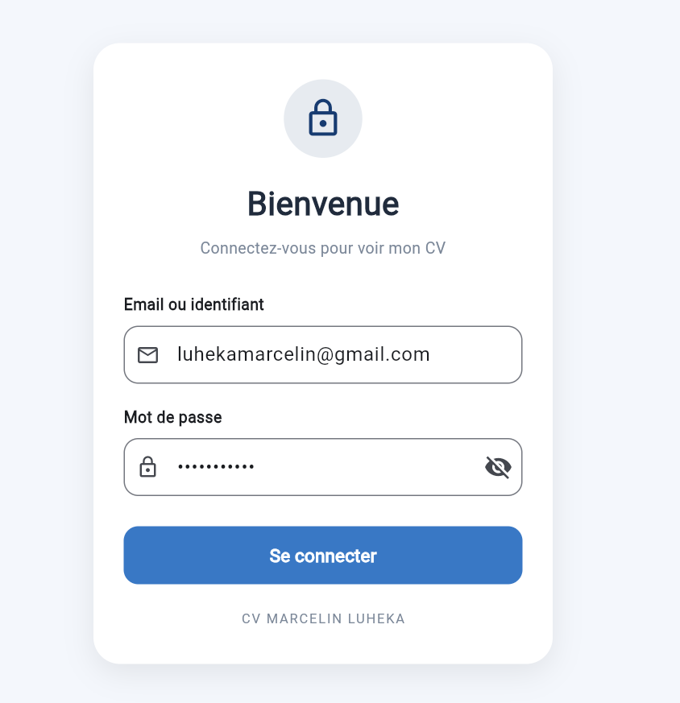
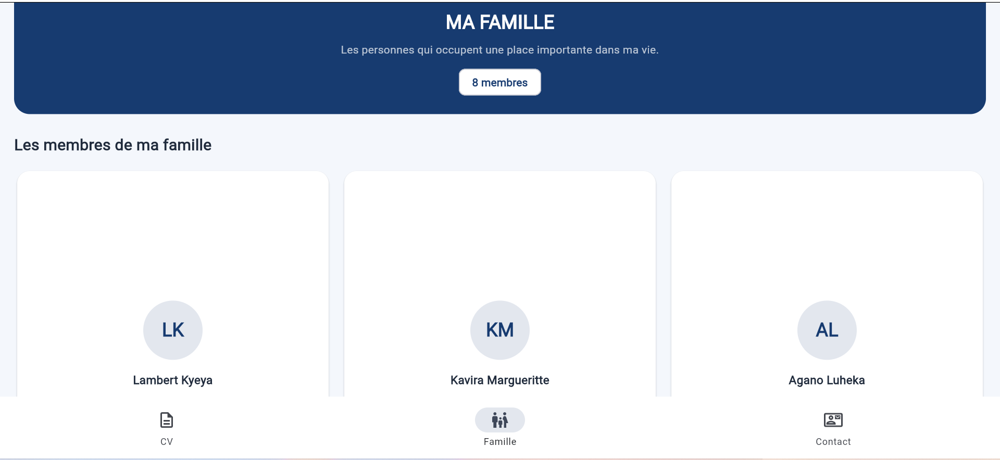
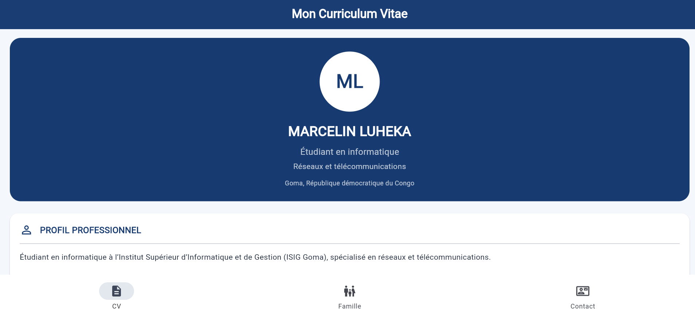

CV MARCELIN LUHEKA

Application de présentation personnelle développée avec Flutter et Dart.

À propos du projet

CV Marcelin Luheka est une application conçue pour présenter mon parcours académique, mes compétences, ma famille et mes coordonnées à travers une interface simple et agréable.

## Captures d'écran de l'application

### Page de connexion

### Ma famille

### Mon CV

### Page de contact

