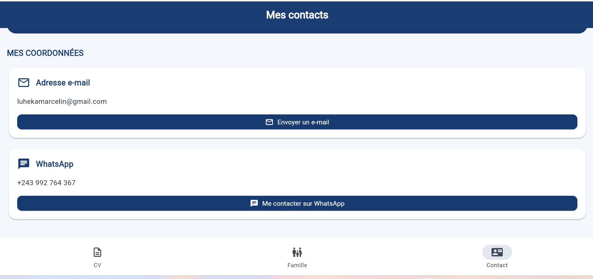

# CV MARCELIN LUHEKA

Application de présentation personnelle développée avec Flutter et Dart.

## À propos du projet

CV Marcelin Luheka est une application conçue pour présenter mon parcours académique, mes compétences, ma famille et mes coordonnées à travers une interface simple et agréable.

## Captures d'écran de l'application

### Page de connexion

### Mon CV

### Ma famille

### Ajouter un membre de la famille

### Page de contact

## Démonstration vidéo

Découvrez les principales fonctionnalités de l'application.

[▶️ Regarder la démonstration vidéo](demo/application-demo-compressee.mp4)

## Technologies utilisées

- Flutter
- Dart
- PHP
- MySQL
- API REST